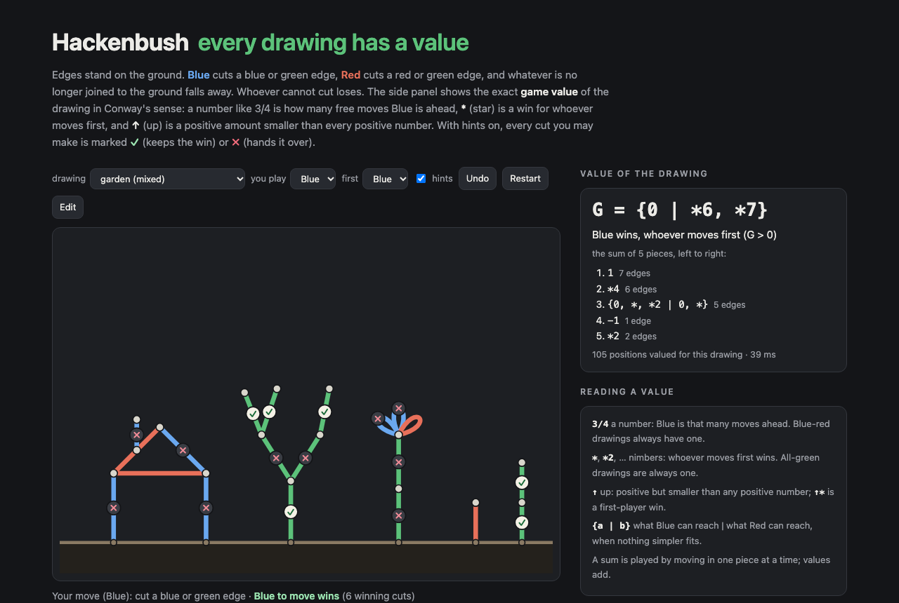

# Hackenbush — every drawing has a value



**Blue-Red-Green Hackenbush** in the browser, with an exact combinatorial-game-theory engine behind it. Edges stand
on the ground; **Blue** (Left) cuts a blue or green edge, **Red** (Right) a red or green one, and whatever is no
longer joined to the ground falls away. Whoever cannot cut loses.

The page shows the **game value** of the drawing in Conway's sense — a number like 3/4, a nimber like \*2, an
infinitesimal like ↑\*, or a general form like {0 | \*6, \*7} — together with the value of each piece that meets the
rest only at the ground. With hints on, every cut you may make is marked ✓ (keeps the win) or ✗ (hands it over),
and a perfect computer plays the other side. Draw your own positions in edit mode (up to 30 edges, loops and
parallel edges allowed).

TypeScript, no runtime dependencies. The engine runs in a Web Worker on the page and under Node for the checks below.

## The engine

[`src/cgt.ts`](src/cgt.ts) — short games in **canonical form**, interned once each:

- A game is an id; its Left and Right options are ids. `make(L, R)` reduces any option lists to the canonical form
  by **deleting dominated options** and **bypassing reversible ones** until nothing changes. Canonical forms are
  unique, so two games are equal exactly when their ids are equal.
- `le(G, H)` is Conway's recursive comparison (G ≤ H unless some H<sup>R</sup> ≤ G or some G<sup>L</sup> ≥ H),
  memoised by id pair; two numbers compare by value. The game being simplified has no id yet, so the reversibility
  test compares against its raw option lists.
- Numbers are recognised on the way in: if every option is a number and every Left option is below every Right one,
  the game is the **simplest number** between them, built directly as {x − 2<sup>−k</sup> | x + 2<sup>−k</sup>}.
- `add` (disjunctive sum), `neg`, nimbers, n·↑, stops, birthday, and `name`, which prints numbers, x + n·↑ + \*m
  (found by subtracting the stop and looking the rest up), ±x, and otherwise {L | R}.

[`src/hackenbush.ts`](src/hackenbush.ts) — a position is an edge list (vertex 0 is the ground) and a bit mask of
the edges still standing. A cut clears a bit and keeps only what is still joined to the ground. `Valuer` splits a
position into the pieces that meet only at the ground, values each piece by its own options, and adds them; both
are memoised by mask. Independent of the engine, the same file has a plain win/lose `Minimax`, a mex-rule `Grundy`
for green drawings, `fusionValue` (Tarjan bridges → fuse every circuit → colon principle up the tree), and
`signExpansion` (Berlekamp's rule).

## Checks

All runs are in [`runs/`](runs), produced by [`tools/verify.mts`](tools/verify.mts) and summarised by
[`tools/report.mts`](tools/report.mts). Node 26, Mac mini, several processes at a time, so times are rough.

**Berlekamp's rule.** Every blue-red stalk of 1–22 edges, valued by the engine, is the number whose sign expansion
is its colours (blue +, red −, bottom first): **8,388,606 / 8,388,606** (161 s).

**Colon and fusion principles.** Every green multigraph (loops and parallel edges allowed) on the ground plus *k*
vertices whose edges all reach the ground, counted as edge lists: the mex-rule brute force, fusion + colon, and the
engine (as \*n) agree on all of them.

| ground + | up to edges | graphs | fusion = mex | engine = \*mex |
|---|---|---|---|---|
| 3 vertices | 9 | 61,741 | 61,741 | 61,741 |
| 4 vertices | 8 | 267,970 | 267,970 | 267,970 |

The nim value always has the parity of the edge count (every edge adds one somewhere in the colon sum), and the
largest nimber seen equals the edge count for up to 7 edges on 3 vertices and up to 8 on 4.

**Coloured graphs against a plain search.** Every coloured multigraph on the ground plus 3 vertices: the engine's
outcome (L, R, P, N from G ≥ 0 and G ≤ 0) equals the outcome of a win/lose search that knows nothing about values;
the value with pieces split and added equals the value of the whole position taken at once; and every blue-red
graph is a number.

| colours | up to edges | graphs | outcome = minimax | split = whole | numbers | distinct values |
|---|---|---|---|---|---|---|
| blue, red | 6 | 133,954 | 133,954 | 133,954 | 133,954 | 115 |
| blue, red, green | 6 | 1,178,816 | 1,178,816 | 1,178,816 | 404,951 | 2,176 |

Of the 1,007,389 six-edge mixed graphs, 345,501 are numbers, 372,288 are x + \*m, 102,428 are x + n·↑ + \*m, and
187,172 are none of these. Also 20,000 / 20,000 random sums of three small drawings: the outcome of the added values
matches the win/lose search on the union.

**Every blue-red-green stalk up to 12 edges** (797,160 stalks, 53 s):

| edges | stalks | distinct values | numbers | x + \*m | x ± ↑\* | other |
|---|---|---|---|---|---|---|
| 1 | 3 | 3 | 2 | 1 | 0 | 0 |
| 2 | 9 | 9 | 4 | 3 | 2 | 0 |
| 3 | 27 | 27 | 8 | 7 | 4 | 8 |
| 4 | 81 | 81 | 16 | 15 | 8 | 42 |
| 6 | 729 | 729 | 64 | 63 | 32 | 570 |
| 8 | 6,561 | 6,561 | 256 | 255 | 128 | 5,922 |
| 10 | 59,049 | 59,049 | 1,024 | 1,023 | 512 | 56,490 |
| 12 | 531,441 | 531,441 | 4,096 | 4,095 | 2,048 | 521,202 |

- **No two stalks have the same value**: 3<sup>n</sup> stalks, 3<sup>n</sup> values. Every stalk of up to 7 edges is born on the day of its length (checked one by one in the tests); at 12 edges the latest birthday is 12.
- The x + \*m stalks are exactly a blue-red stalk *x* with *m* green edges on top (plus the all-green stalk \*n):
  2<sup>n</sup> − 2 + 1 per length, checked string by string. The x ± ↑\* stalks are exactly a blue-red stalk with
  green then blue (↑\*) or green then red (↓\*) on top, plus GB = ↑\* and GR = ↓\*.
- Everything else is a general form. The smallest: GBB = {0, ↑\* | 0}, GBR = {0, \* | 0, ↑\*},
  GGB = {0, \*, \*2 | 0, \*}.

## Tests

`npm test` (vitest, 13 tests): the standard small games and their names (↑\* = {0, \* | 0}, ⇑ = {0 | ↑\*}, \*3 + \*5
= \*6, ↑ + ↓ = 0), simplest numbers, ↑ against 1/1024, small stalks, Berlekamp's rule on all 8,190 blue-red stalks
up to 12 edges, x + \*m and x + ↑\* stalks, distinct values and birthdays for all 3,279 stalks up to 7 edges, the
fusion principle on hand-made cycles and 150 random green drawings against mex, the engine's outcome against minimax
on 200 random mixed drawings, sums of pieces, cutting off what floats, and every preset.

## Run it

```sh
npm install
npm run dev                          # the page
npm test
node tools/verify.mts signexp 22     # → runs/signexp-22.json
node tools/verify.mts green 4 8
node tools/verify.mts graphs 3 6 BRG
node tools/verify.mts stalks 12
node tools/verify.mts sums 20000
node tools/report.mts                # the tables above
```

## References

- E. R. Berlekamp, J. H. Conway, R. K. Guy, *Winning Ways for your Mathematical Plays*, 2nd ed., vol. 1, A K Peters,
  2001 (Hackenbush, the colon and fusion principles, ↑ and \*).
- J. H. Conway, *On Numbers and Games*, 2nd ed., A K Peters, 2001.
- A. N. Siegel, *Combinatorial Game Theory*, Graduate Studies in Mathematics 146, AMS, 2013 (canonical forms,
  dominated and reversible options).

## License

MIT
